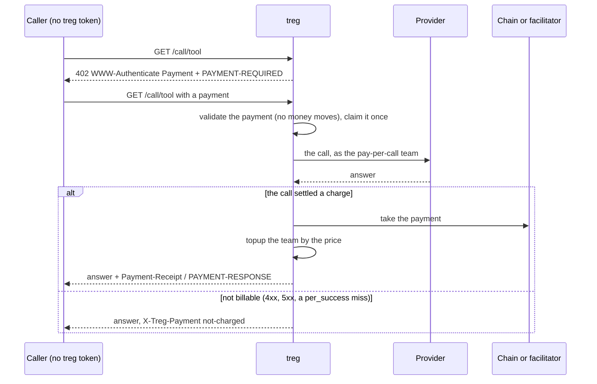

# Pay per call

An agent with no treg account calls a catalog tool and pays for that one call in stablecoins. A
`/call/<endpoint id>` that carries no treg credential (`X-Treg-Token` or the session cookie) is
answered with HTTP 402 and payment offers, and the caller retries with a payment:

- **MPP** (the `Payment` HTTP authentication scheme, `Authorization: Payment …`): Tempo TIP-20
  stablecoins, and USDC on Base through the same EVM method x402 uses.
- **x402** v2 `exact` (`PAYMENT-SIGNATURE`): USDC on Base by EIP-3009, settled by an x402
  facilitator. Standard x402 clients are accepted (`route_binding="resource"`): a payment is
  bound by the echoed terms and the resource URL.

Signed-in calls never take this path, and the feature is off unless a protocol is switched on.
`pympp` is imported only by `infra/payments.py`.

## What can be paid per call

`pay_per_call.offer_for` offers a call only when its price is one fixed figure known before the
call: a catalog endpoint, platform-eligible, not routed, not asynchronous, not spooled, with no
`ceiling_param`, `cost.type` `per_call` or `per_success`, `unit: call`, `per: 1`, and no
cost key beyond the plain price fields (reported charges, tables, settle rules, usage meters and
modifiers all price a call from the request or the answer). The price is
`with_margin(_platform_estimate_micro(cost))`, the figure reserve holds, and must be at least
`TREG_PAY_PER_CALL_MIN_PRICE_MICRO` (default and minimum 10,000, Stripe's one-cent minimum for
machine payments). Anything else answers 401 `not_authenticated` with a `reason`
(`not_a_catalog_tool`, `method_not_allowed`, `variable_price`, `free`, `below_minimum`) and no
offer. Sub-cent and variable-price tools stay on team balances: a payment fixed up front cannot be
partly refunded, and the ledger has no refund entry.

## One paid call

The call runs as the **pay-per-call team**, named by `TREG_PAY_PER_CALL_TEAM_TOKEN` (an API token
of that team), through the ordinary call road: reserve, relay, settle against the team's prepaid
balance. Its balance is a float that operations fund with a grant. The payment is split in two:
`infra/payments.py` wraps each pympp method's `broadcast` so the route handler only validates
(pympp's `validate` hook: the challenge HMAC, the request binding, expiry, and for EVM the
facilitator's `/verify`). The router then decides from the call's `X-Treg-Cost-Micro`:

| Outcome | Payment | Team ledger | Caller sees |
|---|---|---|---|
| Billable answer, payment taken | broadcast / settled | reserve, settle, then `topup` of the price (`payment_ref` `tempo:<tx>` or `evm:<tx>`) | the answer, `X-Treg-Payment: charged`, `X-Treg-Paid-Micro`, receipt headers, `Cache-Control: private` |
| Not billable | never taken | reserve, release | the answer, `X-Treg-Payment: not-charged` |
| Billable, taking the payment fails | not taken | reserve, settle (treg paid the provider) | a fresh 402; the answer is withheld |
| Refused before the call (team balance empty, daily cap, flow control) | never taken | nothing or release | 503 `pay_per_call_unavailable` for treg's own 402, else the refusal, with `X-Treg-Payment: not-charged` |

A taken payment is a `topup` in the same unit (integer micro-USD = 6-decimal stablecoin base units),
so the five ledger entries are unchanged. `CreditBlock.stripe_payment_intent` holds the payment
reference and its unique index makes a repeated top-up a no-op. A top-up that fails after the
payment was taken is logged for reconciliation and never fails the caller's answer.

**One payment, one call.** Before the call the credential's payload (the signed payment itself,
not its wrapping) is claimed in the shared store until two hours have passed; the claim is kept
whatever the outcome, so a validated payment cannot buy unlimited free failing calls, and
concurrent presentations of one credential run once (the others get 409
`payment_already_used`). pympp's own replay store then rejects a settled payment again.

**Pushed Tempo transactions are refused.** A `type: hash` credential is a transaction the payer
already sent; it could not be left untaken when the call is not billable, so it is stripped before
pympp sees it and the caller gets a fresh 402.

## What reaches the provider

The paid call relays the caller's request with these removed: `Authorization: Payment …`,
`Payment-Authorization`, `PAYMENT-SIGNATURE`, `Idempotency-Key` (every payer shares one team, so a
label would let one payer replay another's answer) and every `X-Treg-*` header (tags, routing and
ceilings belong to signed-in teams). Credential injection is unchanged.

## Configuration

Each protocol is switched on alone and `Settings` checks only its own settings, naming every
missing or malformed one in a single startup error.

| Group | Required when | Settings |
|---|---|---|
| Shared | either protocol is on | `TREG_PAY_PER_CALL_TEAM_TOKEN`, `TREG_PAYMENTS_SECRET_KEY` (32+ bytes, the same on every worker), `TREG_PAYMENTS_REALM` (bound into every challenge: the public host, never a per-replica name), `TREG_KV_URL` (Redis 6.2+, the claim and replay store); optional `TREG_PAY_PER_CALL_MIN_PRICE_MICRO` |
| x402 | `TREG_X402_ENABLED` | `TREG_X402_RECIPIENT`, `TREG_X402_NETWORK` (`base` or `base-sepolia`), and a facilitator: either `TREG_X402_CDP_API_KEY_ID` + `TREG_X402_CDP_API_KEY_SECRET` (Coinbase's facilitator, a signed JWT per request, as `@coinbase/x402`) or `TREG_X402_FACILITATOR_URL` (https; plain http only on loopback) with optional `TREG_X402_FACILITATOR_AUTHORIZATION`, never both |
| MPP | `TREG_MPP_ENABLED` | `TREG_MPP_TEMPO_RECIPIENT`, `TREG_MPP_TEMPO_CHAIN_ID` (4217 mainnet, 42431 Moderato); optional `TREG_MPP_TEMPO_CURRENCIES` (default OUSD then USDC.e on mainnet, OUSD then pathUSD on Moderato), `TREG_MPP_TEMPO_RPC_URL`, `TREG_MPP_TEMPO_FEE_PAYER_KEY` |

With both on, the x402 network and the Tempo chain must both be mainnets or both testnets. With a
fee payer, Tempo offers sponsor the payer's fees, which a wallet holding
only OUSD (not a fee token) needs; each sponsored transaction is simulated with `eth_call` before
broadcast.

Set up the pay-per-call team with no connections of its own (an own key would serve the call
unmetered and no payment would be taken), no daily cap, and archive opt-out, since every payer
shares its archive scope.

## Limits

- Only `/call/`; MCP, `/catalog/call/` and `/table/` still need a token.
- No per-payer rate limit: the team's flow control applies to all payers together.
- When taking the payment fails after a billable answer, treg has paid the provider and is not paid
  back; the answer is withheld.
- MPP sessions are not offered: each call is one payment.
